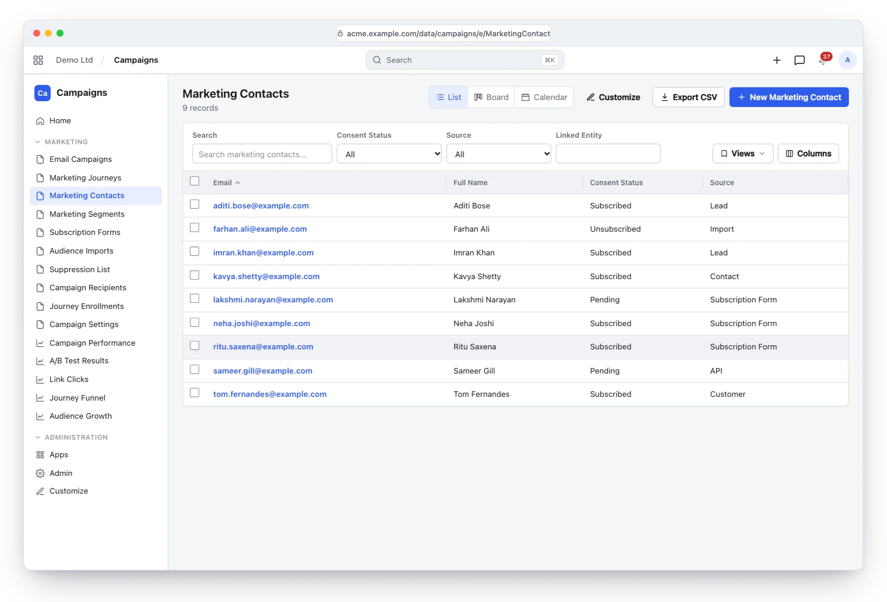
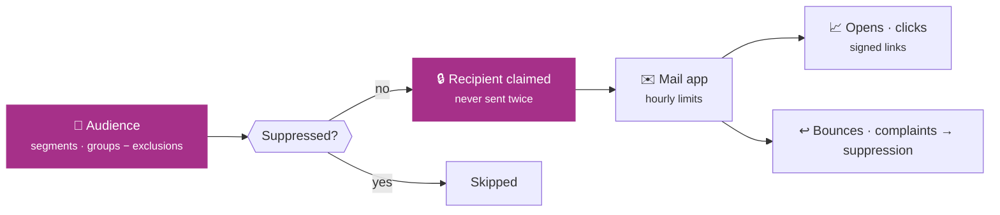
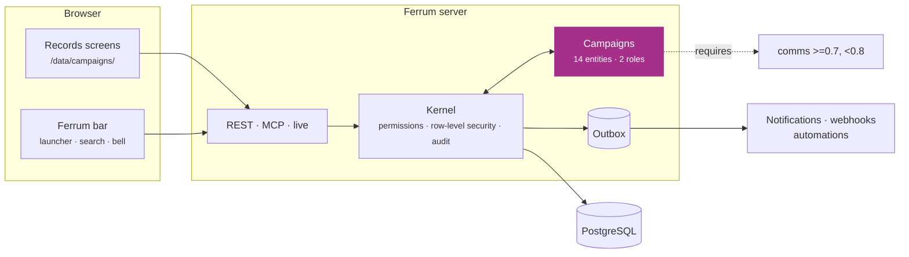
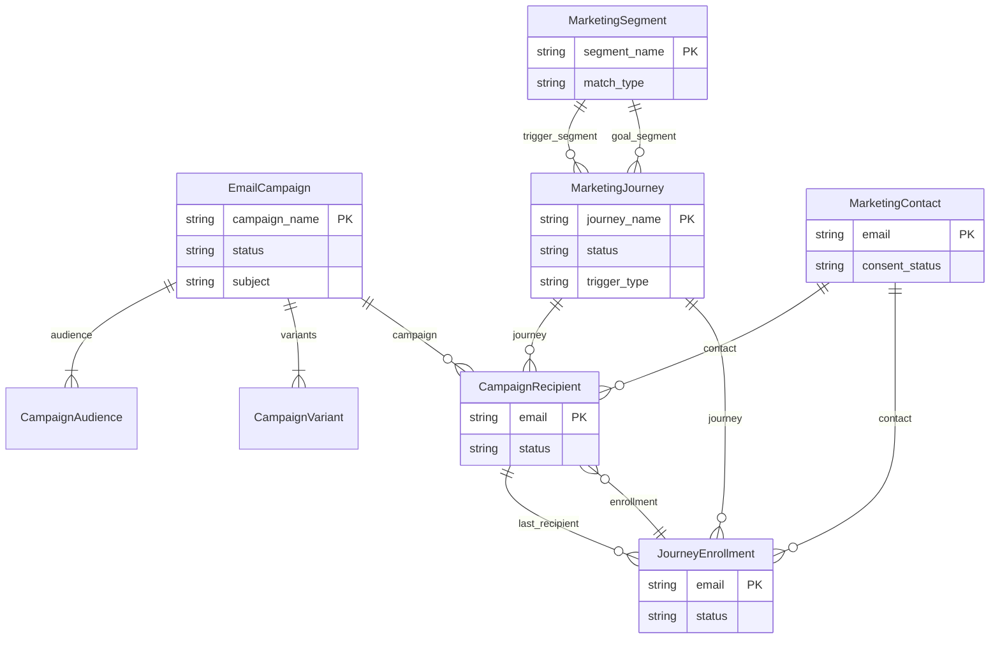

<div align="center">

<picture>
  <source media="(prefers-color-scheme: dark)" srcset="docs/assets/banner-dark.svg">
  
</picture>

[](https://github.com/CBFerrum/ferrum-app-campaigns/actions/workflows/ci.yml)     

**A native app for [Ferrum](https://github.com/CBFerrum/Ferrum), the open-source, AI-first business platform.**

[Overview](#overview) · [Highlights](#highlights) · [Screenshots](#screenshots) · [How it works](#how-it-works) · [Data model](#data-model) · [Install](#install) · [Develop](#develop) · [Changelog](#changelog)

</div>

---

## Overview

Ferrum Campaigns runs email marketing on top of the Mail app: marketing contacts with consent
evidence, segments compiled to parameterized SQL, campaigns with A/B tests and schedules, open and
click tracking with signed links, a suppression list honoured by every send, double opt-in signup
forms, and journeys that send, wait and branch over time.


| At a glance | |
|---|---|
| 📦 Version | `0.1.1` |
| 🧱 Platform | Ferrum `>=0.3, <0.4` |
| 🔗 Requires | comms `>=0.7, <0.8` |
| 🖥️ Interface | Ferrum's records screens (`/data/campaigns/`) |
| 🗃️ Records | 14 entities in 1 package |
| 👥 Roles | 2: Marketing User, Marketing Manager |
| 📊 Reports | 5 |
| 🧪 Tests | 19 Rust tests |


## Highlights

<table>
<tr>
<td width="50%" valign="top">

### 👥 Contacts with consent
One per address, consent evidence, attributes; only the person can opt back in.

</td>
<td width="50%" valign="top">

### 🎯 Segments
Fields, attributes, groups and engagement, compiled to parameterized SQL with live counts.

</td>
</tr>
<tr>
<td width="50%" valign="top">

### 🧪 Campaigns and A/B tests
Subjects and content tested on a share; the winner goes to the rest.

</td>
<td width="50%" valign="top">

### 📈 Tracking
Signed open and click tracking; privacy proxies and scanners counted apart.

</td>
</tr>
<tr>
<td width="50%" valign="top">

### 🚫 Suppression and bounces
A suppression list and a signed bounce and complaint webhook.

</td>
<td width="50%" valign="top">

### 🛤️ Journeys
Triggers, waits in local time, branches and attribute updates.

</td>
</tr>
</table>

## Screenshots

<picture>
  <source media="(prefers-color-scheme: dark)" srcset="docs/assets/campaigns-dark.webp">
  
</picture>

<p align="center"><sub>Marketing contacts with their consent status.</sub></p>

> [!TIP]
> The screenshots follow your GitHub theme: switch between light and dark to see both.

## How it works

### Sending a campaign



### Inside Ferrum



Everything Campaigns adds is ordinary Ferrum metadata and Rust: its records get lists, forms,
search, permissions, an audit trail, exports and the REST and MCP APIs for free, so AI agents work
with them under the same rules as people.

## Data model

The main records and how they connect (14 entities in all; `packages/` has every field).



### Roles

| Role | What it is for | Entities |
|---|---|---|
| **Marketing User** | Day-to-day email marketing - keeps the audience (contacts, segments, imports), drafts and tests their own campaigns and reads the results; a manager sends them. | 13 |
| **Marketing Manager** | Runs email marketing - sends and cancels campaigns, builds journeys and signup forms, manages consent, the suppression list, settings and the bounce webhook. | 15 |

<details>
<summary><b>Reports (5)</b></summary>

- Campaign Performance
- Ab Test Results
- Link Clicks
- Journey Funnel
- Audience Growth

</details>

## Install

Workspace administrators install it from **Apps** (`/store/`) in Ferrum; it ships in the
official Ferrum server image. It needs **comms** `>=0.7, <0.8` installed first. Self-hosters building their own image enable the
`campaigns` feature of the server. Everything it adds is also available to AI agents over
Ferrum's MCP server, within each person's permissions.

## Develop

Clone it next to the platform:

```text
work/
├── ferrum/            https://github.com/CBFerrum/Ferrum
└── ferrum-app-campaigns/
```

Point the platform dependencies at your checkout (this file is git-ignored):

```toml
# .cargo/config.toml
[patch."https://github.com/CBFerrum/Ferrum"]
ferrum-calc = { path = "../ferrum/crates/calc" }
ferrum-domain = { path = "../ferrum/crates/domain" }
ferrum-kernel = { path = "../ferrum/crates/kernel" }
ferrum-meta = { path = "../ferrum/crates/meta" }
```

The tests need PostgreSQL with an ordinary (non-superuser) role, so row-level security
applies:

```bash
createuser ferrum --pwprompt && createdb -O ferrum ferrum_campaigns_test
cargo test
```

`FERRUM_CAMPAIGNS_TEST_DATABASE_URL` overrides the database URL.


It also builds on [ferrum-app-comms](https://github.com/CBFerrum/ferrum-app-comms), and its tests on [ferrum-app-crm](https://github.com/CBFerrum/ferrum-app-crm) and [ferrum-app-erp](https://github.com/CBFerrum/ferrum-app-erp), which Cargo takes from GitHub.
To work on them alongside this app, clone them into the same folder and add to the same file:

```toml
[patch."https://github.com/CBFerrum/ferrum-app-comms"]
ferrum-app-comms = { path = "../ferrum-app-comms" }
[patch."https://github.com/CBFerrum/ferrum-app-crm"]
ferrum-app-crm = { path = "../ferrum-app-crm" }
[patch."https://github.com/CBFerrum/ferrum-app-erp"]
ferrum-app-erp = { path = "../ferrum-app-erp" }
```


### Project layout

```text
app.yaml      the manifest: id, version, requirements, what it adds to Ferrum
packages/     metadata: entities, roles, reports, workflows, print formats
src/          the app's logic in Rust: hooks, actions, endpoints, upkeep jobs
tests/        integration tests against a real PostgreSQL
CHANGELOG.md  what changed in each version
```

## Changelog

| Version | Highlights |
|---|---|
| **0.1.1** | Installs beside today's Mail app: it required Comms 0.1, so a workspace with Mail, Chat and Calendar as they are now (Comms 0.7) could not install … |
| **0.1.0** | First release: email marketing on top of the Mail app. Marketing contacts with consent evidence (time, source, keyed IP hash) and custom … |

Every version is in [CHANGELOG.md](CHANGELOG.md).

## License

[AGPL-3.0-only](LICENSE), like the platform. Part of [Ferrum](https://github.com/CBFerrum/Ferrum) ·
[Report an issue](https://github.com/CBFerrum/ferrum-app-campaigns/issues)
