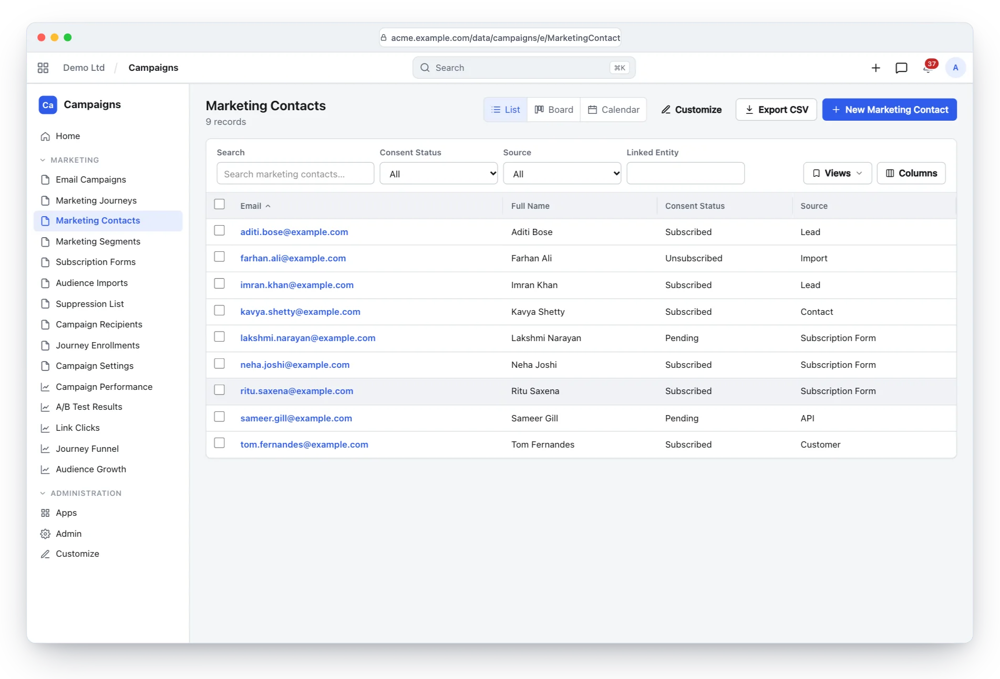
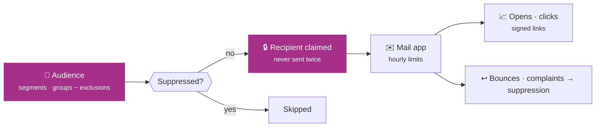
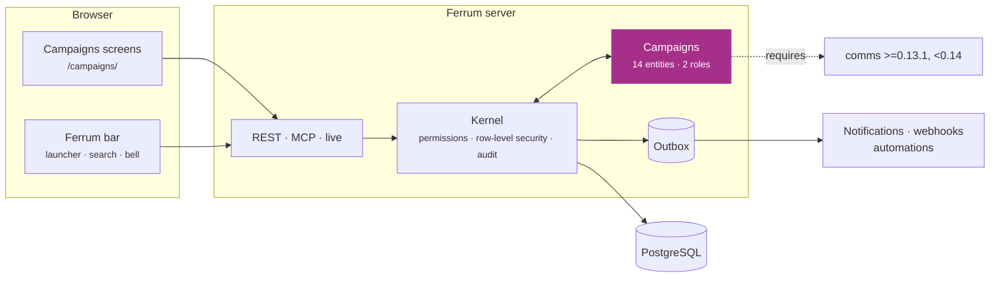
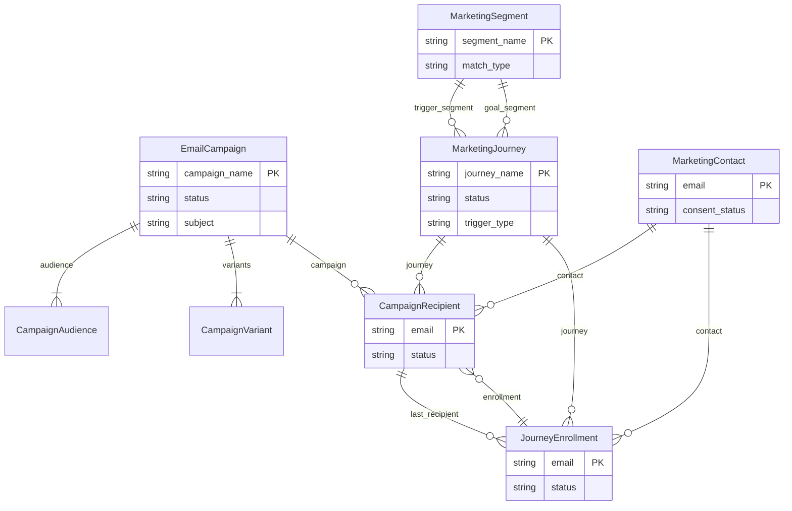

<div align="center">

<picture>
  <source media="(prefers-color-scheme: dark)" srcset="docs/assets/banner-dark.svg">
  
</picture>

[](https://github.com/CBFerrum/ferrum-app-campaigns/actions/workflows/ci.yml)     

**A native app for [Ferrum](https://github.com/CBFerrum/Ferrum), the open-source, AI-first business platform.**

[Overview](#overview) · [Highlights](#highlights) · [Screenshots](#screenshots) · [How it works](#how-it-works) · [Data model](#data-model) · [Install](#install) · [Develop](#develop) · [Changelog](#changelog)

</div>

---

## Overview

Ferrum Campaigns runs email marketing on top of the Mail app: marketing contacts with consent
evidence, segments compiled to parameterized SQL, campaigns with A/B tests and schedules, open and
click tracking with signed links, a suppression list honoured by every send, double opt-in signup
forms, and journeys that send, wait and branch over time.


| At a glance | |
|---|---|
| 📦 Version | `0.3.3` |
| 🧱 Platform | Ferrum `>=0.3.2, <0.4` |
| 🔗 Requires | comms `>=0.13.1, <0.14` |
| 🖥️ Interface | Its own screens at `/campaigns/` (campaigns, results, audiences), and the records screens for the rest |
| 🗃️ Records | 14 entities in 1 package |
| 👥 Roles | 2: Marketing User, Marketing Manager |
| 📊 Reports | 5 |
| 🧪 Tests | 22 Rust tests, 112 for the screens |


## Highlights

<table>
<tr>
<td width="50%" valign="top">

### 👥 Contacts with consent
One per address, consent evidence, attributes; only the person can opt back in.

</td>
<td width="50%" valign="top">

### 🎯 Segments
Fields, attributes, groups and engagement, compiled to parameterized SQL with live counts.

</td>
</tr>
<tr>
<td width="50%" valign="top">

### 🧪 Campaigns and A/B tests
Subjects and content tested on a share; the winner goes to the rest.

</td>
<td width="50%" valign="top">

### 📈 Tracking
Signed open and click tracking; privacy proxies and scanners counted apart.

</td>
</tr>
<tr>
<td width="50%" valign="top">

### 🚫 Suppression and bounces
A suppression list and a signed bounce and complaint webhook.

</td>
<td width="50%" valign="top">

### 🛤️ Journeys
Triggers, waits in local time, branches and attribute updates.

</td>
</tr>
</table>

## Screenshots

<picture>
  <source media="(prefers-color-scheme: dark)" srcset="docs/assets/campaigns-dark.webp">
  
</picture>

<p align="center"><sub>Marketing contacts with their consent status.</sub></p>

> [!TIP]
> The screenshots follow your GitHub theme: switch between light and dark to see both.

## How it works

### Sending a campaign



### Inside Ferrum



Everything Campaigns adds is ordinary Ferrum metadata and Rust: its records get lists, forms,
search, permissions, an audit trail, exports and the REST and MCP APIs for free, so AI agents work
with them under the same rules as people.

## Data model

The main records and how they connect (14 entities in all; `packages/` has every field).



### Roles

| Role | What it is for | Entities |
|---|---|---|
| **Marketing User** | Day-to-day email marketing - keeps the audience (contacts, segments, imports), drafts and tests their own campaigns and reads the results; a manager sends them. | 13 |
| **Marketing Manager** | Runs email marketing - sends and cancels campaigns, builds journeys and signup forms, manages consent, the suppression list, settings and the bounce webhook. | 15 |

<details>
<summary><b>Reports (5)</b></summary>

- Email Campaign Performance
- Ab Test Results
- Link Clicks
- Journey Funnel
- Audience Growth

</details>

## Install

Workspace administrators install it from **Apps** (`/store/`) in Ferrum; it ships in the
official Ferrum server image. It needs **comms** `>=0.11, <0.12` installed first. Self-hosters building their own image enable the
`campaigns` feature of the server. Everything it adds is also available to AI agents over
Ferrum's MCP server, within each person's permissions.

## Develop

Clone it next to the platform:

```text
work/
├── ferrum/            https://github.com/CBFerrum/Ferrum
└── ferrum-app-campaigns/
```

Point the platform dependencies at your checkout (this file is git-ignored):

```toml
# .cargo/config.toml
[patch."https://github.com/CBFerrum/Ferrum"]
ferrum-calc = { path = "../ferrum/crates/calc" }
ferrum-domain = { path = "../ferrum/crates/domain" }
ferrum-kernel = { path = "../ferrum/crates/kernel" }
ferrum-meta = { path = "../ferrum/crates/meta" }
ferrum-apps = { path = "../ferrum/crates/apps" }
```

The tests need PostgreSQL with an ordinary (non-superuser) role, so row-level security
applies:

```bash
createuser ferrum --pwprompt && createdb -O ferrum ferrum_campaigns_test
cargo test
```

`FERRUM_CAMPAIGNS_TEST_DATABASE_URL` overrides the database URL.


It also builds on [ferrum-app-comms](https://github.com/CBFerrum/ferrum-app-comms), and its tests on [ferrum-app-crm](https://github.com/CBFerrum/ferrum-app-crm) and [ferrum-app-erp](https://github.com/CBFerrum/ferrum-app-erp), which Cargo takes from GitHub.
To work on them alongside this app, clone them into the same folder and add to the same file:

```toml
[patch."https://github.com/CBFerrum/ferrum-app-comms"]
ferrum-app-comms = { path = "../ferrum-app-comms" }
[patch."https://github.com/CBFerrum/ferrum-app-crm"]
ferrum-app-crm = { path = "../ferrum-app-crm" }
[patch."https://github.com/CBFerrum/ferrum-app-erp"]
ferrum-app-erp = { path = "../ferrum-app-erp" }
```


### The interface

Its screens are in `ui/` (React, built with the packages of the sibling checkout `../ferrum/web`; nothing to
install in `ui/`). The built files in `ui/dist/` are committed and embedded in the crate, so rebuild before you commit:

```bash
cd ui
npm run test       # the logic of every screen, without a browser
npm run typecheck
npm run build      # writes ui/dist and a stamp of the sources it came from
npm run check      # fails if dist/ is stale or over the size budget
```

### Project layout

```text
app.yaml      the manifest: id, version, requirements, what it adds to Ferrum
packages/     metadata: entities, roles, reports, workflows, print formats
src/          the app's logic in Rust: hooks, actions, endpoints, upkeep jobs
ui/           its own screens (src/ is the code, dist/ the built release)
tests/        integration tests against a real PostgreSQL
CHANGELOG.md  what changed in each version
```

## Changelog

| Version | Highlights |
|---|---|
| **0.4.5** | Rebuilt on the tuned design system: better menu icons, a lighter first page, a visible scroll cue, cleaner print. |
| **0.4.4** | One-click unsubscribe headers on every campaign and journey email. |
| **0.4.3** | The redesigned interface: the upgraded design system, shaped loading, told-apart states. |
| **0.4.2** | Works with Mail, Chat and Calendar 0.11 and 0.12. |
| **0.4.1** | Requires Mail, Chat and Calendar 0.11. |
| **0.4.0** | Unsubscribes and confirmed subscriptions go on the platform's one record of consent, which every campaign and journey asks before mailing. |
| **0.3.16** | Its reports' names in Arabic and Hindi. |
| **0.3.15** | Its names in Arabic and Hindi; the last English sentences translated. |
| **0.3.14** | Sentences built in code are words too, in Arabic and Hindi. |
| **0.3.13** | The assistant knows its records. |
| **0.3.12** | Rebuilt with Ferrum-Frontend 5b22e7b: its own words in Arabic and Hindi. |
| **0.3.11** | Rebuilt with Ferrum-Frontend 6537d65: once-shown answers kept; English isolated right to left; its own words translatable by a workspace. |
| **0.3.10** | Rebuilt with Ferrum-Frontend d5d98f2: a workspace's own interface words; pictures in attachment fields; a duplicate value said so; its own screens mirror right to left. |
| **0.3.9** | Rebuilt with Ferrum-Frontend 63280d3: right to left, pages mirror; the records pages' words in Arabic and Hindi. |
| **0.3.8** | Rebuilt with Ferrum-Frontend a64416a: a box whose default is 1 shows ticked. |
| **0.3.7** | Rebuilt with Ferrum-Frontend 922fcfb: action dialogs say every refusal and ask once. |
| **0.3.6** | Rebuilt with Ferrum-Frontend a76295e: times on a person's own clock when they chose one. |
| **0.3.5** | Times on the workspace's clock; rebuilt with Ferrum-Frontend 24c3951. |
| **0.3.4** | Rebuilt with Ferrum-Frontend bb60115: empty numbers read as the server reads them; settings open as their record. |
| **0.3.3** | The review's settings findings open the page that fixes them; a signup form gives HTML to paste; the campaign report is Email Campaign Performance, apart from CRM's. |
| **0.3.2** | Requires Comms 0.10, so it installs beside the platform's Comms again. |
| **0.3.1** | Rebuilt with Ferrum-Frontend 00dea07: a workflow state's kept fields are read-only, its needed ones required. |
| **0.3.0** | campaigns that belong to CRM's |
| **0.2.2** | Rebuilt with Ferrum-Frontend daeadda: actions say what they did. |
| **0.2.1** | Rebuilt with Ferrum-Frontend 80ff179: labels name their fields, and linked titles show their titles. |
| **0.2.0** | Its own interface at `/campaigns/`: write, preview on a computer and a phone, test, check who will get it and why others are left out, schedule and send a campaign from one page; results as charts over time with the A/B outcome; segments with a live count; import contacts from a CSV file with column mapping … |
| **0.1.1** | Installs beside today's Mail app: it required Comms 0.1, so a workspace with Mail, Chat and Calendar as they are now (Comms 0.7) could not install … |
| **0.1.0** | First release: email marketing on top of the Mail app. Marketing contacts with consent evidence (time, source, keyed IP hash) and custom … |

Every version is in [CHANGELOG.md](CHANGELOG.md).

## License

[AGPL-3.0-only](LICENSE), like the platform. Part of [Ferrum](https://github.com/CBFerrum/Ferrum) ·
[Report an issue](https://github.com/CBFerrum/ferrum-app-campaigns/issues)
